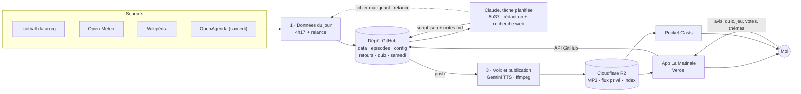

<div align="center">

# 🎙️ La Matinale

**Mon podcast d'actualité privé, fabriqué chaque nuit par l'IA, prêt vers 6 h pour le train.**

Léa et Hugo racontent en ~20 minutes l'actu IA, le foot, la politique, le jeu vidéo, le cinéma et une histoire de culture générale, avec un quiz. Zoé conclut avec la météo. Le samedi, une grande édition avec jeu et débat ; le dimanche, un documentaire.


</div>

---

## La grille

| Jour | Format | Durée |
|---|---|---|
| **Lundi → vendredi** | Les thèmes dans l'ordre choisi dans l'app, le quiz du jour (réponse le lendemain), la météo de Zoé | ~20 min |
| **Samedi** | **La grande édition** : la semaine en 3 minutes · le face-à-face Léa contre Hugo (vote dans l'app) · le jeu de 8 questions (score dans l'app) · le guide du week-end (sorties pays de Gex, Genève, Lausanne, matchs et chaînes, écrans) · les réponses du jeu · la météo du week-end | ~25 min |
| **Dimanche** | **Le documentaire** : un seul sujet de culture générale en plusieurs actes, un quiz dessus, la météo | ~10 min |

### Les thèmes de la semaine

| | Thème | Durée | Ce qu'on y trouve |
|---|---|---|---|
| ⚽ | **Football** | 4 min | L'OL et le Real d'abord, puis 2 ou 3 affiches de grosses équipes racontées (jamais une liste de scores), avec la chaîne qui diffuse en France |
| 🏛️ | **Politique** | 4 min | France, Suisse romande, monde : des faits, chaque opinion attribuée |
| 🤖 | **Nouveautés IA** | 3 min | Modèles, outils, API, et ce que ça change pour un dev |
| 🎮 | **Jeux vidéo** | 3 min | Sorties, annonces, tests marquants |
| 🎬 | **Cinéma et séries** | 3 min | Les sorties du mercredi, la série du moment, sans spoiler |
| 📚 | **Culture générale** | 2 min | La réponse au quiz d'hier, une histoire tirée de l'éphéméride, le quiz du jour (3 ou 4 choix) |
| 🌤️ | **Météo** (Zoé) | 1 min | Toujours en dernier · **Lausanne** lun., mar., jeu. · **Ferney-Voltaire** mer., ven., sam., dim. |

Ordre, durées, pauses et nouveaux thèmes se règlent **dans l'app** (onglet Thèmes) ; tout est stocké dans [`config/rubriques.json`](config/rubriques.json).

---

## Comment ça marche



| Heure (Genève, été) | Étape | Qui s'en charge | Fichier produit |
|---|---|---|---|
| **4 h 17** | Scores et classements, météo de la ville du jour, éphéméride ; le samedi, météo du week-end et sorties OpenAgenda | GitHub Actions · [`data.yml`](.github/workflows/data.yml) | `data/<date>.json` |
| **5 h 37** | Vérifie les données (et relance la collecte si elles manquent), lit retours, quiz et votes, recherche web, écrit le dialogue, valide, pousse | Tâche planifiée Claude · consigne [`prompts/redaction.md`](prompts/redaction.md) | `episodes/<date>/script.json` + `notes.md` |
| **~6 h 00** | Voix réplique par réplique (petit silence entre les voix), jingle, chapitres, volume -16 LUFS, publication | GitHub Actions · [`episode.yml`](.github/workflows/episode.yml), déclenché par le push du script | MP3 + `feed.xml` + `episodes.json` sur R2 |
| **~6 h 10** | Épisode disponible dans l'app (≤ 5 min) et dans Pocket Casts | — | — |
| **7 h 23** | Chien de garde : l'épisode du jour est-il rédigé et publié ? Sinon, notification push | GitHub Actions · [`watchdog.yml`](.github/workflows/watchdog.yml) | — |

> Les tâches GitHub sont en UTC : l'hiver, la collecte passe à 3 h 17 et le chien de garde à 6 h 23. La rédaction reste à 5 h 37 toute l'année. Les minutes « bizarres » sont voulues : GitHub saute parfois les tâches prévues à l'heure pile.

### Les filets de sécurité

- **Données manquantes** : la rédaction pousse `requests/data-<date>`, ce qui relance la collecte, et attend jusqu'à 8 minutes. En dernier recours, la météo est lue directement chez Open-Meteo. Aucun score n'est jamais inventé.
- **Longueur** : la validation refuse un script sous 85 % de la durée visée (≈ 3 230 mots en semaine), avec le compte de mots par thème.
- **Forme** : quiz exigé quand il y a une culture générale ou un documentaire, jeu de 8 questions et débat exigés le samedi, météo en dernier, Zoé seulement dans la météo. Si un écart passe quand même, l'épisode sort avec un avertissement plutôt que pas du tout.
- **Voix** : si Gemini refuse le mode réplique par réplique, retour automatique au mode groupé ; si le modèle est saturé, bascule sur le modèle « lite ». Un thème qui échoue est sauté, l'épisode sort et le run passe en rouge.

---

## L'app

Une appli web privée ([`app/`](app/)), protégée par un mot de passe facultatif, pensée pour le téléphone (thème clair ou sombre automatique) :

| Écran | Ce qu'on y fait |
|---|---|
| **Écouter** | « Grâce à tes retours » (ce que la rédaction a changé suite à tes avis) ; lecteur avec chapitres, −15 s / +30 s, vitesse, reprise ; chapitre suivant / précédent depuis les écouteurs ; quiz du jour, jeu et face-à-face du samedi ; invite à donner son avis en fin d'épisode ; résumé et sources ; épisodes précédents. Le son continue d'un onglet à l'autre (mini-lecteur) et résiste aux coupures réseau. |
| **Mon avis** | Un pouce par thème entendu, des pastilles toutes prêtes (« trop long », « sujet raté »…), un mot si besoin ; ce qui est envoyé reste affiché et se corrige en renvoyant ; brouillon gardé hors réseau ; consignes permanentes (retrait annulable) |
| **Thèmes** | Ordre par glisser-déposer, durée, consigne, sites de référence, pause, création et suppression |
| **Réglages** | Durée en semaine, grande édition du samedi, documentaire du dimanche (durée et sujet souhaité), coût estimé du mois |

Chaque action est un commit dans le dépôt (`retours.md`, `config/rubriques.json`, `quiz.json`, `samedi.json`), lu par la rédaction du lendemain. Un bandeau propose la mise à jour quand une nouvelle version est en ligne. Détails : [`app/README.md`](app/README.md).

---

## Ce que ça coûte

| Poste | Coût |
|---|---|
| Recherche et rédaction (Claude) | inclus dans l'abonnement Pro |
| Voix (Gemini 3.8 Flash TTS, 25 jetons par seconde d'audio) | ≈ 0,26 $ par épisode de semaine, ≈ 6 à 8 $/mois · **le tarif double au 1er janvier 2027** |
| GitHub Actions, Cloudflare R2, Vercel | 0 € (offres gratuites) |
| Données (football-data.org, Open-Meteo, Wikipédia, OpenAgenda) | 0 € |

Le coût du mois est estimé dans l'app (Réglages → Coût) ; la facture exacte est sur Google AI Studio.

---

## L'écouter

Le flux est privé : son adresse contient une clé secrète (`FEED_SECRET`) et n'est indexée nulle part.

- **Dans l'app** : ouvre-la dans Safari puis **Partager → Sur l'écran d'accueil**.
- **Dans Pocket Casts** : onglet **Découvrir**, colle `PUBLIC_BASE_URL/FEED_SECRET/feed.xml`, puis **S'abonner**. Marche aussi avec Overcast et Apple Podcasts (abonnement par URL).

---

## Régler l'émission

| Je veux… | Où |
|---|---|
| Donner mon avis, ajouter une consigne permanente | App → **Mon avis** (stocké dans [`retours.md`](retours.md)) |
| Changer l'ordre, la durée ou la consigne d'un thème, en créer un | App → **Thèmes** |
| Choisir le sujet du prochain documentaire, régler les durées | App → **Réglages** |
| Changer le ton, le format, les règles éditoriales | [`prompts/redaction.md`](prompts/redaction.md) |
| Changer les villes de la météo ou leur jour | `meteo` dans [`config/rubriques.json`](config/rubriques.json) |
| Changer la zone des sorties du samedi | `sorties` dans [`config/rubriques.json`](config/rubriques.json) |
| Changer de jingle ou de pochette | Remplacer [`assets/jingle.mp3`](assets/) (5 à 6 s) ou `assets/cover.jpg` |
| Changer une voix | Variables GitHub `VOICE_LEA`, `VOICE_HUGO`, `VOICE_ZOE` (Gemini : Kore, Aoede, Leda, Zephyr, Puck, Charon, Orus, Fenrir…) |
| Régler le silence entre les répliques | Variable `TTS_TURN_GAP_MS` (350 par défaut) ; `TTS_PER_TURN=0` pour l'ancien mode |
| Comparer Gemini et ElevenLabs | Actions → **0 · Test de voix** → « comparaison » (secret `ELEVENLABS_API_KEY` requis) |
| Ajouter une équipe suivie | `football.favouriteTeamIds` dans la config (ID football-data.org) |

---

## Les boutons utiles (onglet Actions)

| Workflow | Quand l'utiliser |
|---|---|
| **0 · Test de voix** | Écouter une minute d'un vrai épisode avec d'autres voix, ou comparer Gemini et ElevenLabs à l'aveugle (liens A/B) |
| **1 · Données du jour** | Relancer la collecte ; champ `date` pour préparer un autre jour (ex. tester les sorties d'un samedi) |
| **3 · Voix et publication** | Republier un épisode (champ `date` facultatif) |
| **4 · Chien de garde** | Vérifier à la main que l'épisode du jour est en ligne |
| **5 · Régénérer le flux** | Reconstruire `feed.xml` sans refaire l'audio |

Pour relancer la **rédaction** hors horaire, déclenche la tâche planifiée « La Matinale — rédaction » depuis Claude.

---

## Suivre la qualité

- **Journal des trous** : chaque `episodes/<date>/notes.md` se termine par « Trous et échecs » (sites inaccessibles, données manquantes, rubriques maigres). C'est là qu'on voit quelles sources lâchent.
- **Continuité** : la rédaction relit les 3 jours précédents ; un sujet déjà traité ne revient que s'il y a du nouveau.
- **Chapitres** : un par thème (ou par partie le week-end), dans le MP3, le flux et l'app.
- **Alertes** : avec l'appli **ntfy** abonnée au sujet `NTFY_TOPIC`, push si la voix échoue ou si l'épisode manque au passage du chien de garde.

---

## Configuration

<details>
<summary><b>Secrets GitHub</b> (Settings → Secrets and variables → Actions)</summary>

| Secret | Rôle |
|---|---|
| `FOOTBALL_DATA_TOKEN` | Jeton football-data.org (offre gratuite) |
| `GEMINI_API_KEY` | Clé Google AI Studio pour la voix |
| `S3_ENDPOINT`, `S3_BUCKET` | Compte et bucket Cloudflare R2 |
| `S3_ACCESS_KEY_ID` / `S3_SECRET_ACCESS_KEY` | Jeton R2 « Lecture/écriture objet » limité au bucket |
| `PUBLIC_BASE_URL` | URL publique `https://pub-….r2.dev` |
| `FEED_SECRET` | Chaîne aléatoire qui rend l'URL du flux impossible à deviner |
| `OPENAGENDA_KEY` | Clé OpenAgenda pour les sorties du samedi (facultatif) |
| `NTFY_TOPIC` | Sujet ntfy privé pour les alertes push (facultatif) |
| `ELEVENLABS_API_KEY` | Seulement pour le test de voix « comparaison » (facultatif) |

L'app a ses propres variables sur Vercel : voir [`app/README.md`](app/README.md).

</details>

<details>
<summary><b>Lancer en local</b></summary>

```bash
npm ci
FOOTBALL_DATA_TOKEN=… npm run data -- --date=2026-10-17   # data/<date>.json
npm run validate -- --date=2026-10-15                     # vérifie un script (durée, quiz, météo…)
GEMINI_API_KEY=… npm run tts:test                         # une minute de voix dans out/
SKIP_PUBLISH=1 GEMINI_API_KEY=… npm run episode -- --date=2026-10-15
```

Prérequis : Node 22 et ffmpeg.

</details>

<details>
<summary><b>Structure du dépôt</b></summary>

```text
config/rubriques.json     thèmes, durées, éditions du week-end, météo, sorties, documentaire
prompts/redaction.md      consigne de la tâche planifiée Claude
src/data.ts               scores, classements, éphéméride, météo, sorties
src/validate.ts           contrôle du script.json (forme et durée)
src/tts/                  voix : gemini.ts, elevenlabs.ts
src/assemble.ts           montage ffmpeg, chapitres, volume
src/publish.ts            envoi sur R2, flux RSS, index des épisodes
src/episode.ts            enchaîne voix → montage → publication
src/ab-upload.ts          test de voix à l'aveugle
app/                      l'appli web (Next.js)
retours.md                mes avis et consignes, lus chaque matin
quiz.json, samedi.json    mes réponses au quiz, au jeu et mes votes
data/                     données du jour (commitées par GitHub Actions)
episodes/                 scripts et notes (commités par Claude)
requests/                 demandes de relance de la collecte
```

</details>

---

<div align="center">
<sub>Usage strictement personnel : l'épisode résume la presse du jour, le flux reste privé.</sub>
</div>
