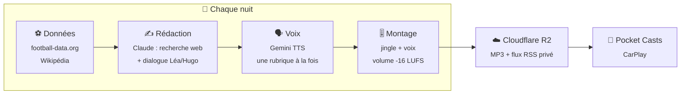

<div align="center">

# 🎙️ La Matinale

**Mon podcast d'actualité privé, fabriqué chaque nuit par l'IA, prêt à 6 h dans ma voiture.**

Léa et Hugo, deux voix françaises, racontent en ~20 minutes l'actu IA, le foot, la politique, le jeu vidéo, le cinéma… et finissent sur une question de culture générale.


</div>

---

## Au programme

| | Rubrique | Durée | Ce qu'on y trouve |
|---|---|---|---|
| 🤖 | **Nouveautés IA** | 4 min | Modèles, outils, API sortis dans les dernières 24 h, et ce que ça change pour un dev |
| ⚽ | **Football** | 4 min | L'OL d'abord, puis le Real Madrid, la Ligue 1, la Ligue des champions et la Premier League |
| 🏛️ | **Politique** | 4 min | France, Suisse romande, monde — des faits, chaque opinion attribuée |
| 🎮 | **Jeux vidéo** | 3 min | Sorties, annonces, tests marquants |
| 🎬 | **Cinéma et séries** | 3 min | Les sorties du mercredi, la série du moment, sans spoiler |
| 📚 | **Culture générale** | 2 min | Une histoire tirée de l'éphéméride, et un quiz pour finir |

Tout se règle dans [`config/rubriques.json`](config/rubriques.json) : durées, consignes, sites de référence, équipes suivies.

---

## Comment ça marche



| Heure (Genève, été) | Étape | Qui s'en charge | Fichier produit |
|---|---|---|---|
| **5 h 00** | Scores, classement, derniers et prochains matchs de l'OL et du Real, éphéméride | GitHub Actions · [`data.yml`](.github/workflows/data.yml) | `data/<date>.json` |
| **5 h 37** | Recherche web par rubrique, écriture du dialogue, vérification du format | Tâche planifiée Claude · consigne [`prompts/redaction.md`](prompts/redaction.md) | `episodes/<date>/script.json` + `notes.md` |
| **~5 h 50** | Voix, montage avec chapitres, publication du MP3 et du flux | GitHub Actions · [`episode.yml`](.github/workflows/episode.yml), déclenché par le push du script | MP3 sur R2 + `feed.xml` |
| **6 h 30** | Chien de garde : l'épisode du jour est-il rédigé et publié ? Sinon, notification push | GitHub Actions · [`watchdog.yml`](.github/workflows/watchdog.yml) | — |

> L'hiver, tout part une heure plus tôt : les crons GitHub sont en UTC.

---

## Ce que ça coûte

| Poste | Aujourd'hui | Si on passe en payant |
|---|---|---|
| Recherche et rédaction (Claude) | inclus dans l'abonnement Pro | — |
| Voix (Gemini 3.8 Flash TTS) | **0 €** (offre gratuite) | ~0,20 $ par épisode de 15 min, soit ~6 $/mois · ×2 à partir de janvier 2027 |
| Données foot, GitHub Actions, stockage R2 | 0 € | — |

---

## L'écouter

Le flux est privé : son adresse contient une clé secrète (`FEED_SECRET`) et n'est indexée nulle part.

1. Ouvre **Pocket Casts** → onglet **Découvrir**.
2. Colle l'adresse `PUBLIC_BASE_URL/FEED_SECRET/feed.xml` dans la barre de recherche.
3. **S'abonner**, puis active le téléchargement automatique.

Ça marche aussi avec Overcast (« Add URL ») et Apple Podcasts (« Suivre une émission par URL »).

---

## Régler l'émission

| Je veux… | Je modifie… |
|---|---|
| **Donner mon avis** (« plus de mercato », « trop long ») | [`retours.md`](retours.md) — lu chaque matin par la rédaction |
| Changer une rubrique, sa durée ou ses sources | [`config/rubriques.json`](config/rubriques.json) |
| Régler l'édition du week-end (10 min, sans politique le dimanche) | `editions` dans [`config/rubriques.json`](config/rubriques.json) |
| Changer le ton, le format, les règles éditoriales | [`prompts/redaction.md`](prompts/redaction.md) |
| Changer de jingle ou de pochette | Remplacer [`assets/jingle.mp3`](assets/) (5 à 6 s) ou `assets/cover.jpg` (3000×3000) |
| Essayer d'autres voix | Actions → **0 · Test de voix**, puis les variables `VOICE_LEA` / `VOICE_HUGO` |
| Passer sur ElevenLabs | Variable `TTS_PROVIDER=elevenlabs` + secret `ELEVENLABS_API_KEY` + variables d'ID de voix |
| Ajouter une équipe suivie | `football.favouriteTeamIds` dans la config (ID football-data.org) |

Voix Gemini à tester : Léa → `Kore`, `Aoede`, `Leda`, `Zephyr` · Hugo → `Puck`, `Charon`, `Orus`, `Fenrir`.

---

## Les boutons utiles (onglet Actions)

| Workflow | Quand l'utiliser |
|---|---|
| **0 · Test de voix** | Écouter un extrait de 20 s avec d'autres voix, sans rien publier |
| **1 · Données du jour** | Relancer la récupération des scores si elle a échoué |
| **3 · Voix et publication** | Republier un épisode (champ `date` facultatif) |
| **4 · Chien de garde** | Vérifier à la main que l'épisode du jour est bien en ligne |

Pour relancer la **rédaction** hors horaire, déclenche la tâche planifiée « La Matinale — rédaction » depuis Claude.

---

## Suivre la qualité

Chaque `episodes/<date>/notes.md` se termine par un journal **« Trous et échecs »** : recherches sans résultat, sites inaccessibles, infos trop anciennes, rubriques maigres. C'est l'endroit à lire pour améliorer les sources.

Une rubrique qui échoue à la synthèse vocale est sautée : l'épisode sort quand même, le run passe en rouge et une notification part.

**Alertes** : avec l'appli gratuite **ntfy** abonnée au sujet `NTFY_TOPIC`, tu reçois un push si la voix échoue ou si, à 6 h 30, l'épisode du jour manque.

**Continuité** : la rédaction relit les notes de la veille et des 3 jours précédents ; un sujet déjà traité ne revient que s'il y a du nouveau.

**Chapitres** : chaque épisode a un chapitre par rubrique (dans le MP3 et dans le flux), pour sauter directement au foot ou au ciné.

---

## Configuration

<details>
<summary><b>Secrets GitHub</b> (Settings → Secrets and variables → Actions)</summary>

| Secret | Rôle |
|---|---|
| `FOOTBALL_DATA_TOKEN` | Jeton football-data.org (offre gratuite) |
| `GEMINI_API_KEY` | Clé Google AI Studio pour la voix |
| `S3_ENDPOINT` | Endpoint S3 du compte Cloudflare R2 |
| `S3_BUCKET` | `matinale` |
| `S3_ACCESS_KEY_ID` / `S3_SECRET_ACCESS_KEY` | Jeton R2 « Lecture/écriture objet » limité au bucket |
| `PUBLIC_BASE_URL` | URL publique `https://pub-….r2.dev` |
| `FEED_SECRET` | Chaîne aléatoire qui rend l'URL du flux impossible à deviner |
| `NTFY_TOPIC` | Nom de sujet ntfy privé pour les alertes push (facultatif) |

</details>

<details>
<summary><b>Lancer en local</b></summary>

```bash
npm ci
FOOTBALL_DATA_TOKEN=… npm run data                 # data/<date>.json
npm run validate -- --date=2026-10-14              # vérifie un script
GEMINI_API_KEY=… npm run tts:test                  # extrait de voix dans out/
SKIP_PUBLISH=1 GEMINI_API_KEY=… npm run episode -- --date=2026-10-14
```

Prérequis : Node 22 et ffmpeg.

</details>

<details>
<summary><b>Structure du dépôt</b></summary>

```text
config/rubriques.json     rubriques, durées, sources, équipes
prompts/redaction.md      consigne de la tâche planifiée Claude
src/data.ts               scores, classements, éphéméride
src/validate.ts           contrôle du script.json
src/tts/                  voix : gemini.ts, elevenlabs.ts
src/assemble.ts           montage ffmpeg + normalisation du volume
src/publish.ts            envoi sur R2 + flux RSS
src/episode.ts            enchaîne voix → montage → publication
assets/jingle.mp3         jingle d'ouverture
assets/cover.jpg          pochette de l'émission
retours.md                mes retours, lus chaque matin par la rédaction
data/                     données du jour (commitées par GitHub Actions)
episodes/                 scripts et notes (commités par Claude)
```

</details>

---

<div align="center">
<sub>Usage strictement personnel : l'épisode résume la presse du jour, le flux reste privé.</sub>
</div>
